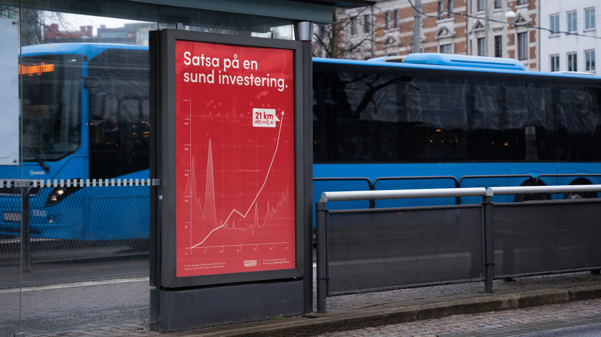
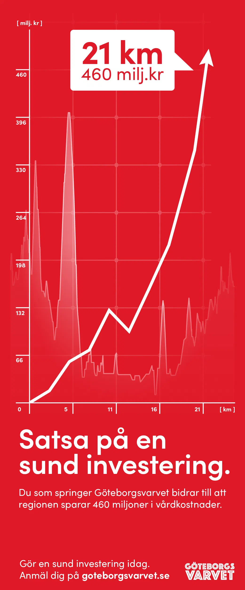
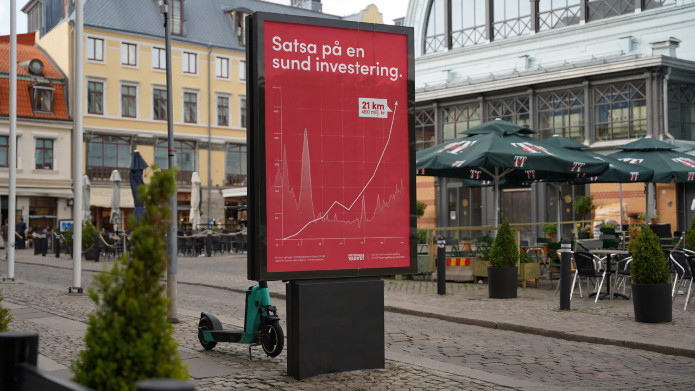
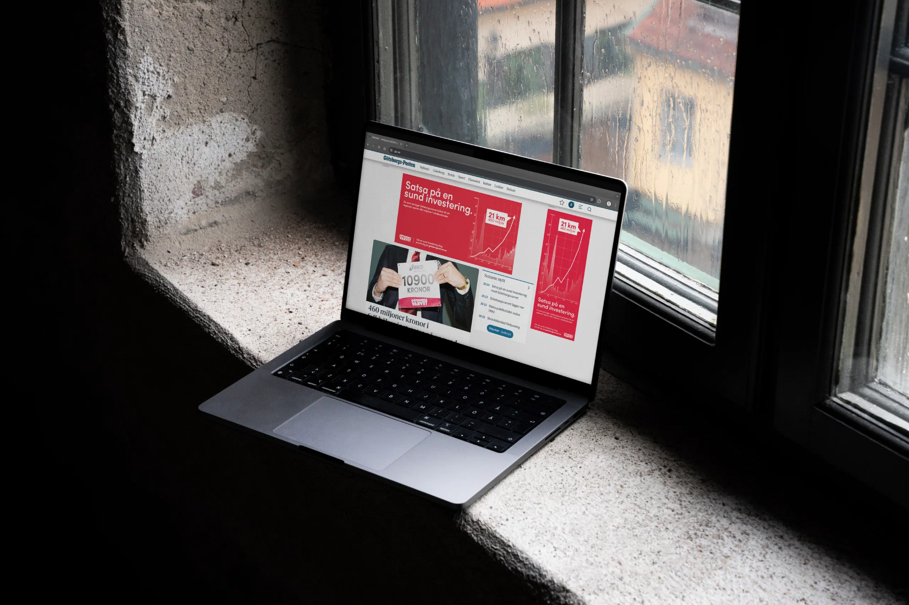

{.large loading="eager"}


Det är inga nyheter att Göteborgsvarvets löpare tillsammans lägger flera år av träning på varje lopp. Eller att staden svarar med en folkfest. Nyheten är att loppet sparar regionen 460 miljoner kronor i vårdkostnader.




{.large}

{.large}



Den siffran ska nå dem som fördelar pengarna, och politiker lyssnar på avkastning. Därför leker kampanjen med uttrycket ”Satsa på en sund investering”. Sund för din hälsa, folkhälsan och ekonomin. Sund-sund-sund. Annonserna kombinerar formspråk från löpar- och finansappar som förstärker budskapet.






{.large}




