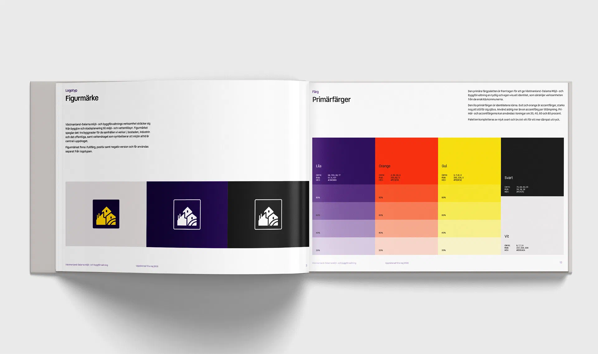
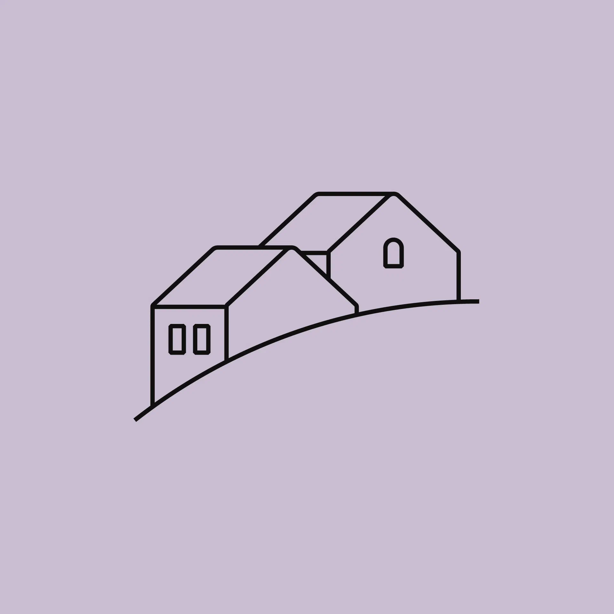
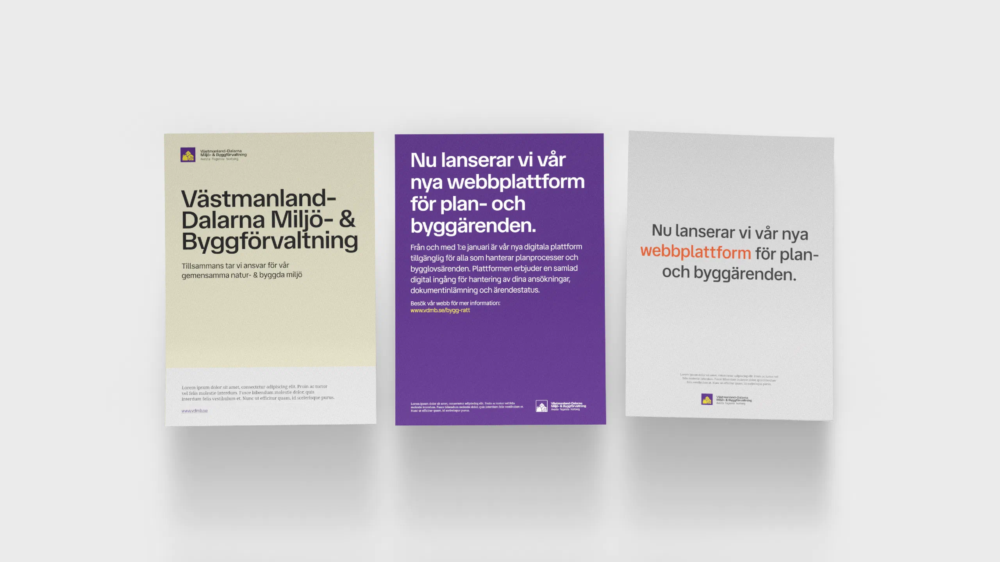
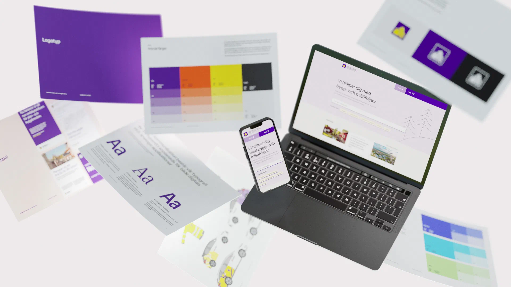
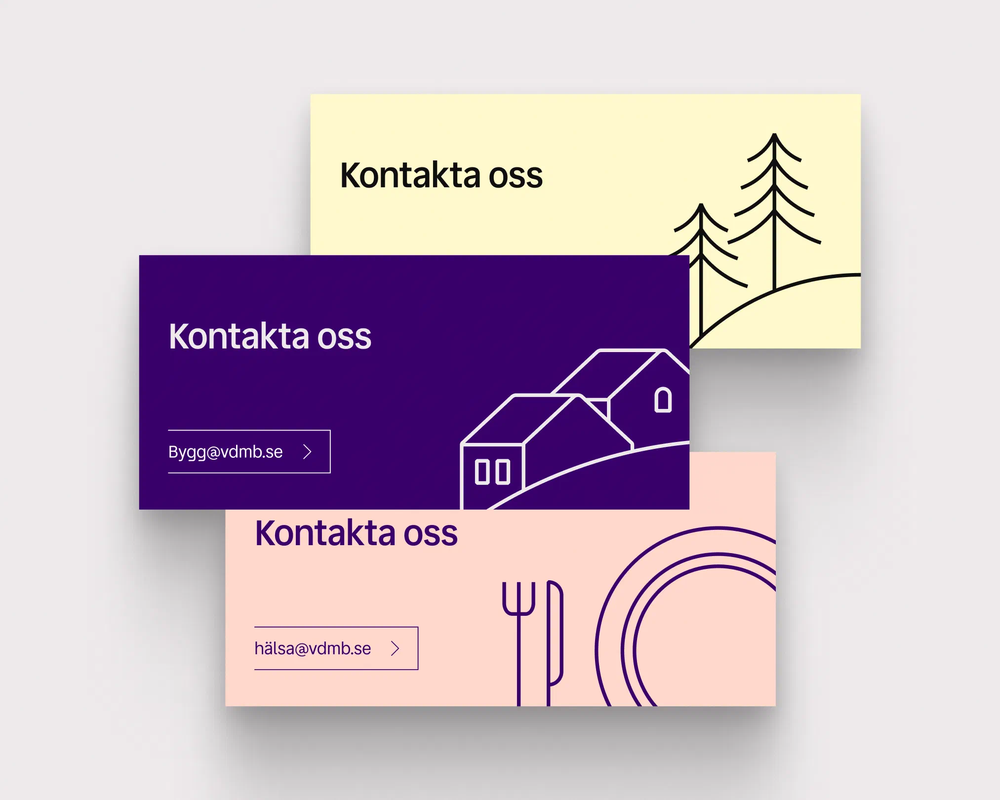
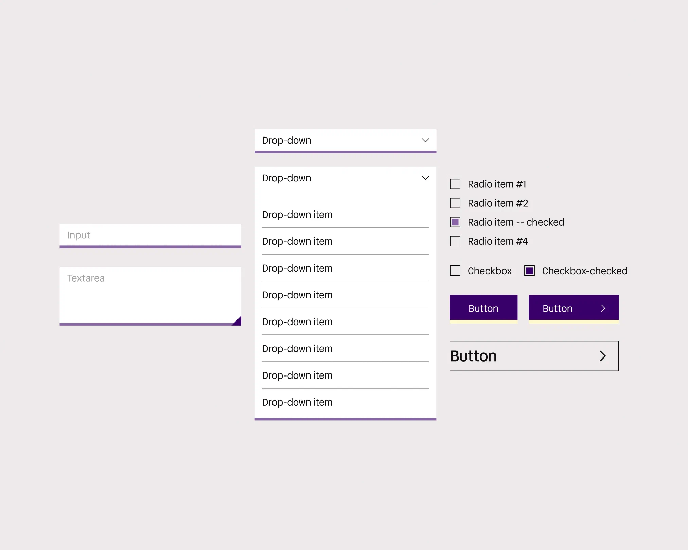
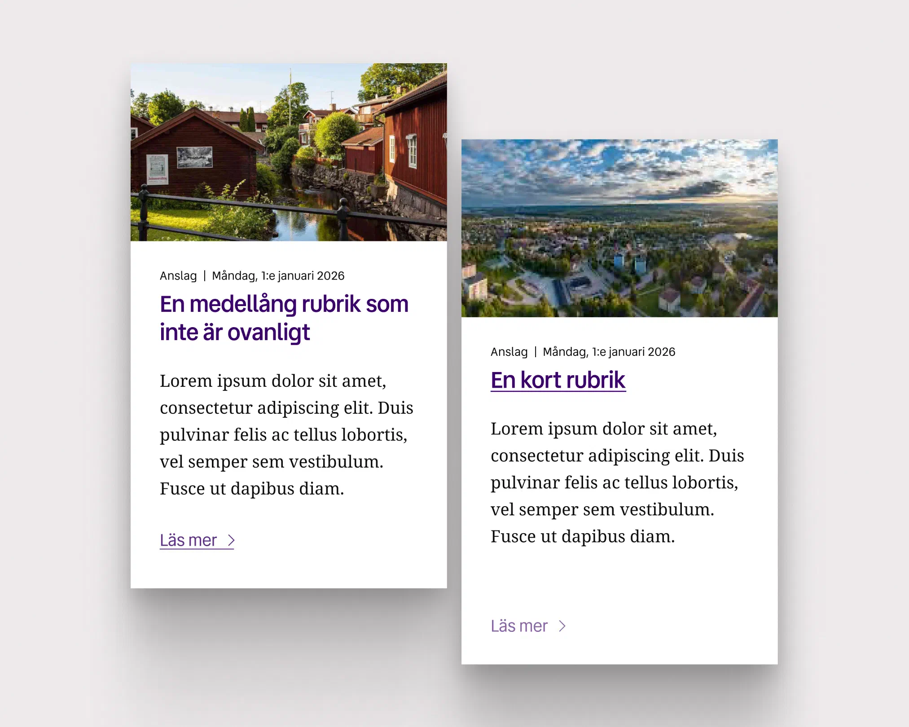
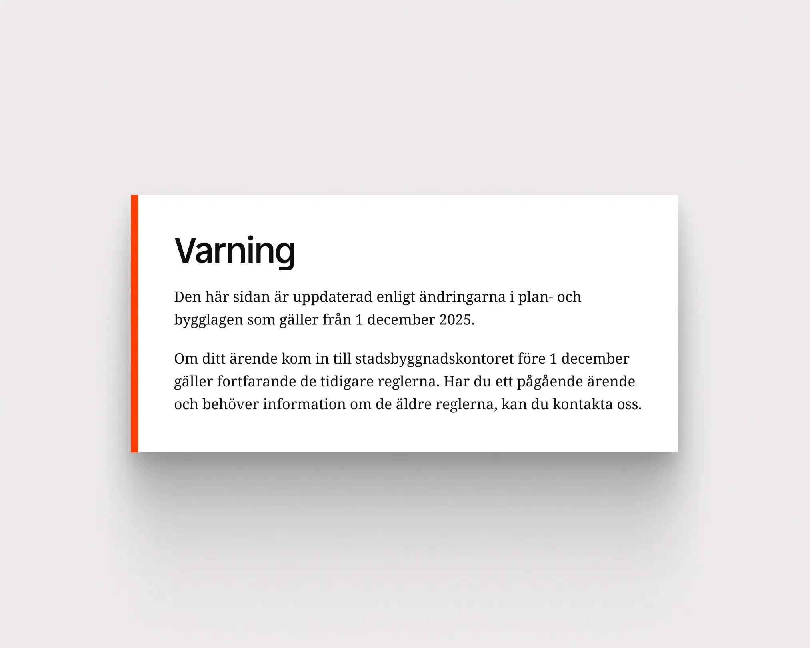



{.large}







Figurmärket samlar hela organisationens uppdrag i ett: bostaden, industrin och miljön.







Lila bär identiteten med gult och orange som primära accenter. Det stilgrepp som blir bärande för varumärkets illustrationer bygger på enkla geometriska linjeillustrationer vars komplexitet kan skalas upp beroende på ändamål.


{.large}


Identiteten tillämpades direkt på organisationens nya hemsida, där förvaltningen samlar digitala e-tjänster och dokument med ärendestatus och annan information som medborgarna är i behov av.


{.large}








