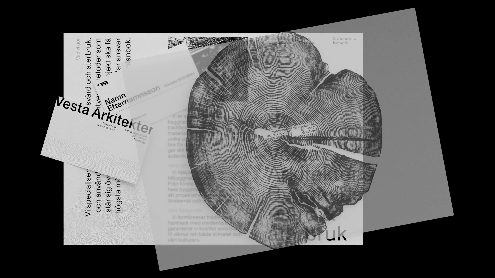
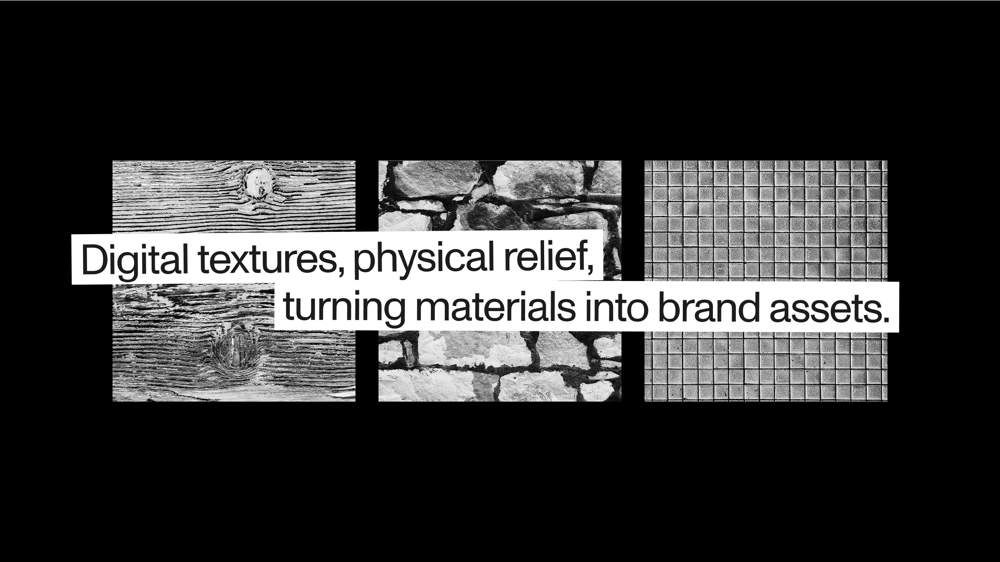
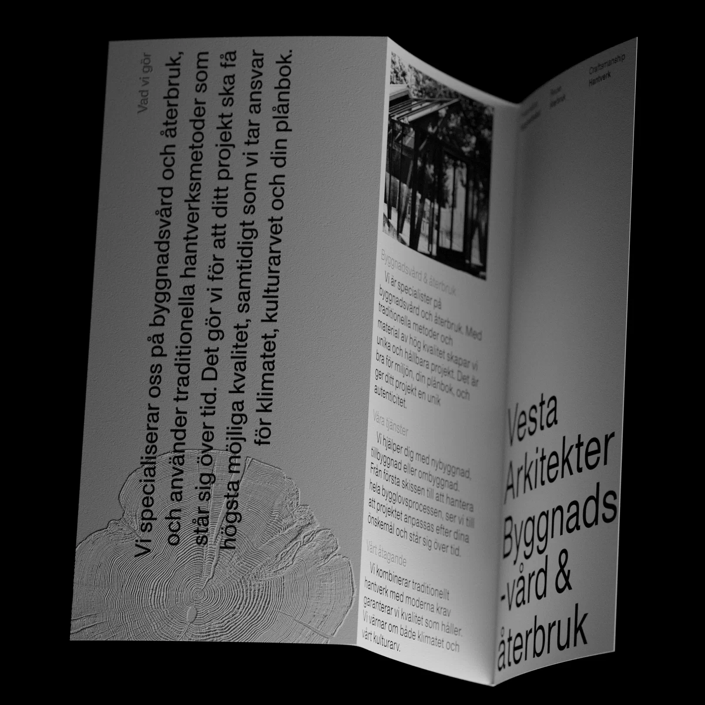
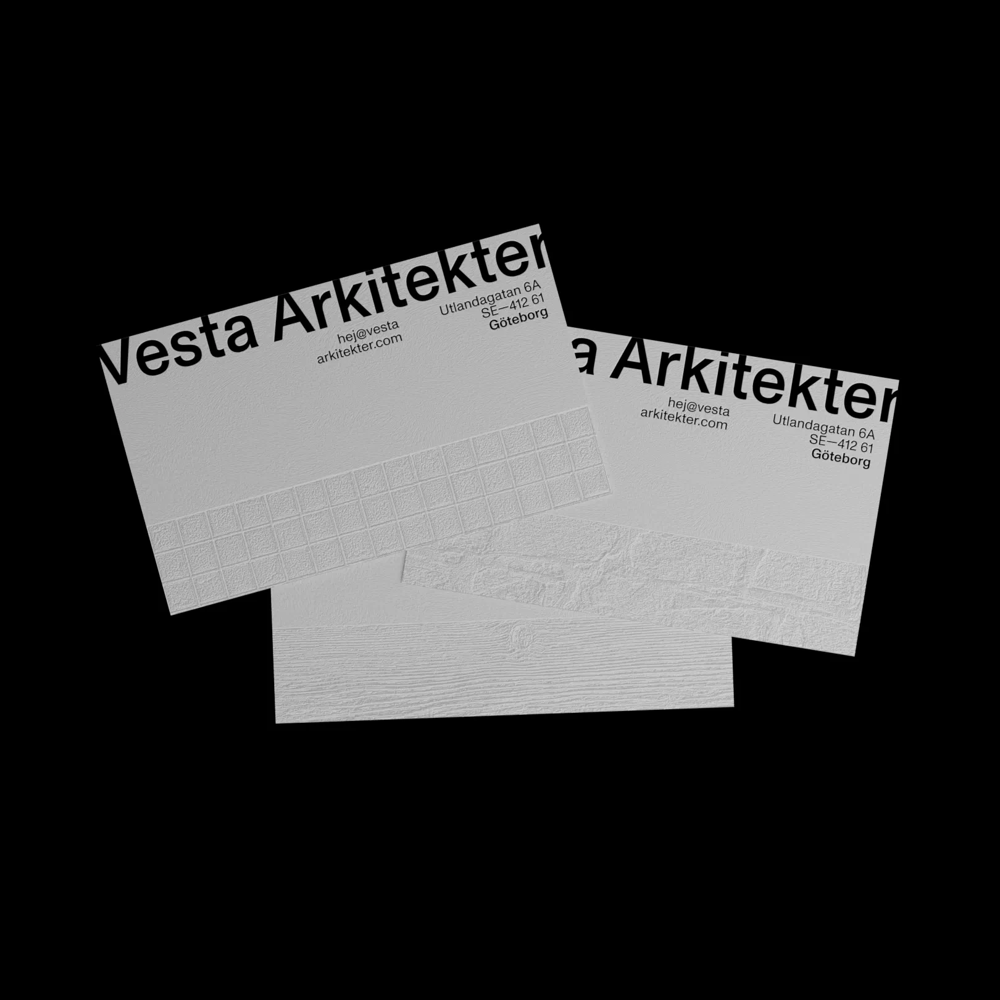
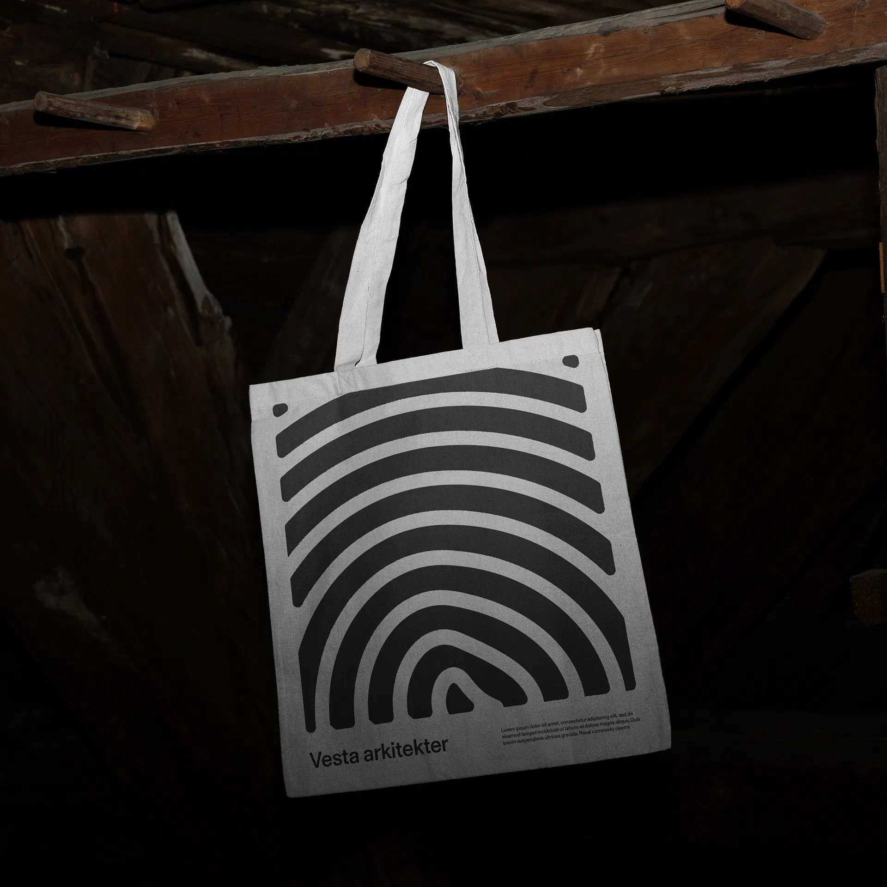
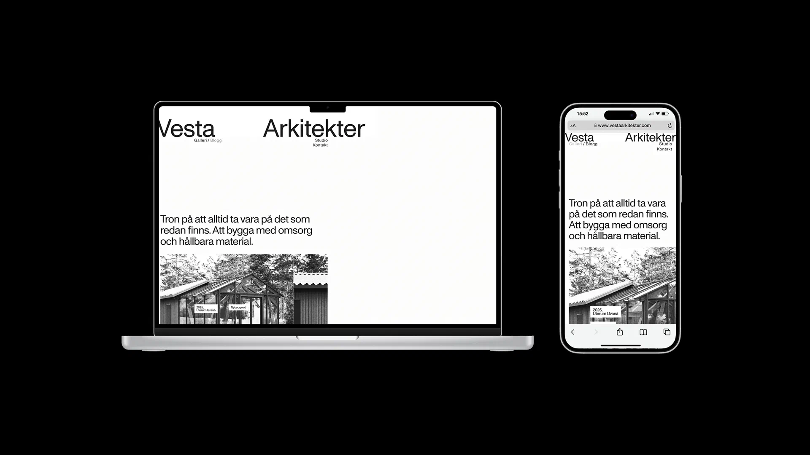
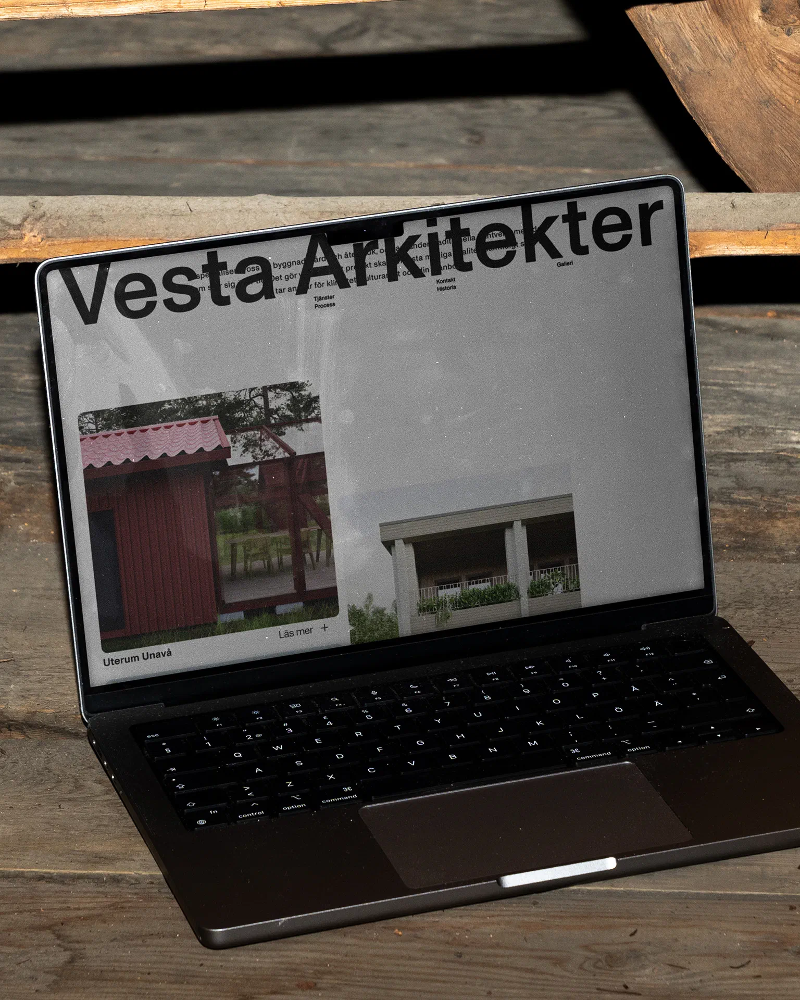
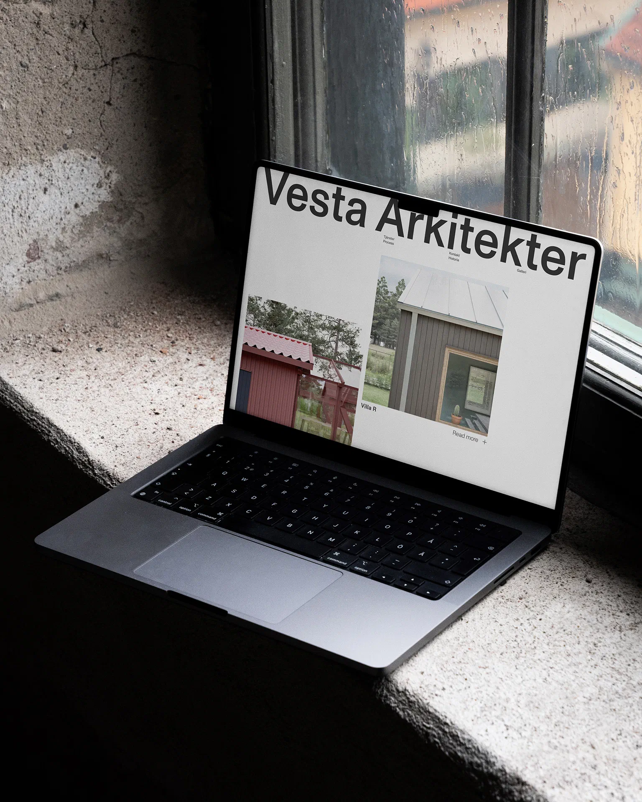
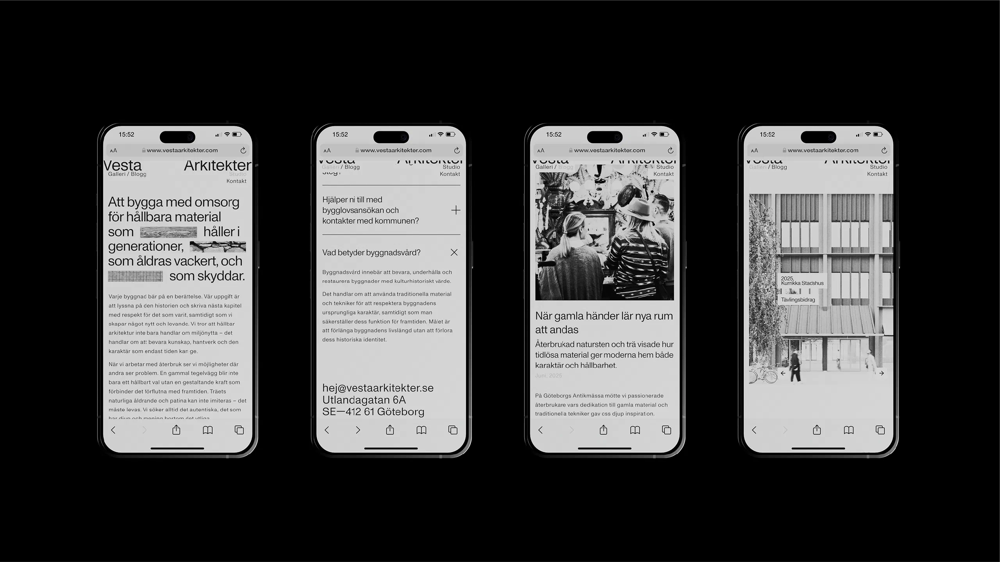
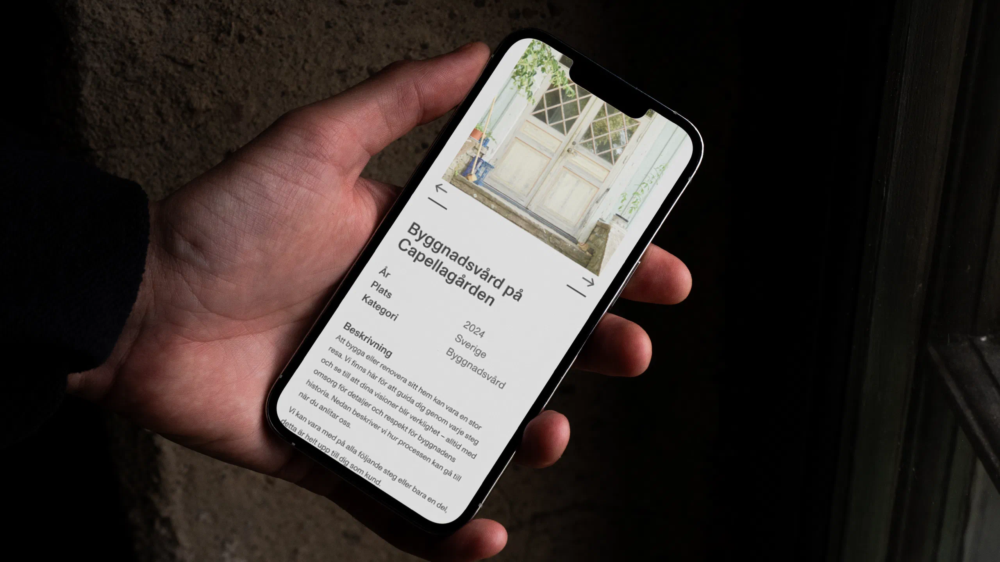



{.large}


”Det är just för att vi är unga och naiva som vi ens vågar testa det här.”



Citatet kommer från uppstartsworkshopen som jag, William och Gabriel höll med Vesta. Det fastnade direkt, och dagen gav mer än så: en tydlig bild av vad de ville med byrån. Därifrån kom riktningen — ett samtida och kaxigt uttryck som lyfter materialen i alla touchpoints.






{.large}


Idén var enkel: skapa ett uttryck som känns taktilt och lyfter naturmaterial i digitala kanaler.














När det var dags att bygga hemsida lades fokus mer på en stilren design, svartvitt och 


{.large}





{.large}

{.large}
